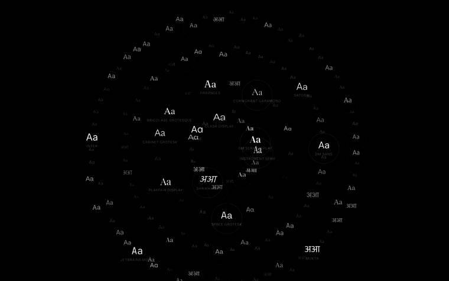
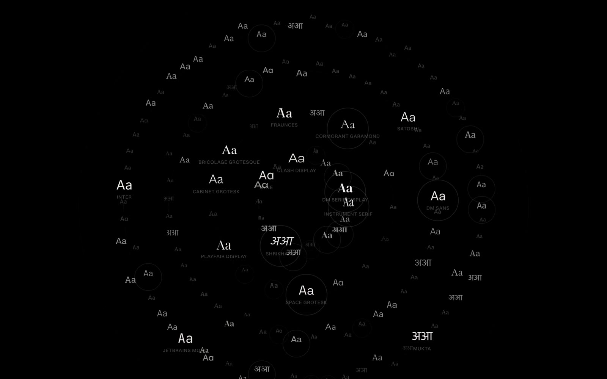

# Typespace

A spatial map of 150 typefaces. Every font sits where its character puts it, written as "Aa" in its own face. Click one and its best partners gather around it. Click a partner and the pair is set as a full specimen page you can type into.

[Open it live →](https://monalisachowdhury23-bit.github.io/typespace/)

[](https://monalisachowdhury23-bit.github.io/typespace/)

## Why I made it

Most pairing tools hand you an answer without a reason. Some generate pairs from embeddings, which you can't question. Others show two fonts side by side and leave the judgement to you. Either way you leave with a pairing and no better sense of why it works.

Typespace shows the reasoning. Where a font sits on the map describes it, the lines between fonts describe how they relate, and the specimen spells out the relationship in plain words: which font is the display voice, which one carries the reader, and whether they pair through kinship or tension.

It also treats Devanagari as a first-class script. Eighteen of the 150 faces carry Devanagari, and bilingual Hindi and English interfaces are an everyday reality for hundreds of millions of people. Pairing across scripts has its own problems (matching stroke weight, sizing by the headline instead of the x-height, keeping conjuncts readable at display sizes), and pairing tools rarely deal with any of them.

## How it works

### The map



Each font has three hand-set scores: how expressive it is (display affinity, 0 to 10), how drawn or constructed it is (humanist to geometric, −1 to +1), and how heavy it looks (visual weight, 1 to 10).

- Display affinity picks the ring. The most expressive faces sit in the middle and the workhorse text faces sit on the outside, across five rings.
- Humanist to geometric sets the angle. Going around a ring, fonts move from drawn and calligraphic to built and rational, so neighbours on a ring are related.
- A deterministic hash of each font's id adds a little jitter, so the map looks the same on every load and you can remember where Inter lives.
- A soft relaxation pass pushes overlapping labels apart, while a spring pulls each font back toward its place on the ring, so tidying never moves a font into the wrong neighbourhood.

Sixteen fonts are drawn larger as anchors and about fifty more sit in a middle tier. The rest are small and reveal their names on hover. That keeps 150 fonts from all competing for attention at once.

### Finding partners

Every pair of fonts gets a compatibility score, computed once at load (about 11,000 comparisons):

- Good partners sit roughly 3 to 6 apart on display affinity, so one leads and one supports.
- Serif with sans, display with text, and mono with serif or sans all score; two similar faces in the same role lose points.
- Fonts score when they are close on the humanist to geometric axis (kinship) or far apart (deliberate contrast). The middle ground scores nothing.
- Two Devanagari fonts get a bonus, and a clear difference in weight earns a little more.

Hover a font and lines draw to its top five partners. Strong pairs pull the line almost straight and weaker ones let it sag, so you can read strength without a number. Line colour shows the kind of relationship: slate for kinship, amber for contrast. When both fonts carry Devanagari the line is dashed, so a Hindi pair still shows whether its fonts are alike or opposed, and the meaning never depends on colour alone.

### Anchoring

Click a font and it flies to the centre on an arc (made from two tweens on x and y with different easings). Up to twelve of its best partners gather in two rings around it, five close and the rest further out, each with its name showing. Every other font moves out past the rings, fades, and stops responding, so the only choices left are real partners. Use the All fonts button, click the anchor again or press Escape to send everything home.

### The specimen

Pick a partner and the field dims under a full-page specimen:

- A composed headline in the display voice with a kicker and deck in the text voice. The headline is editable, so you can proof your own words.
- The display font's alphabet, numerals and weights next to the text font in a running paragraph, a small interface fragment and tabular figures.
- A live x-height overlay: a lowercase x from both fonts at the same point size, laid on top of each other.
- A sentence describing the pair, a tension meter from kin to contrast, and a button that swaps which font leads.

If either font is Devanagari, the specimen switches to a bilingual version: a Hindi headline with an English echo, the Devanagari consonants, vowel signs and numerals, and the overlay compares a Devanagari letter with a Latin one at the same size.

## Details

- Fonts load in tiers: anchors immediately, the middle tier when the browser is idle, the rest in small batches after that.
- Every font on the map is real HTML text set in its own face, and the connection lines are SVG underneath. All motion is GSAP on transform and opacity.
- The field drifts slightly at rest and a few anchors pulse now and then. With reduced motion turned on, drift and pulses stop and every transition resolves almost instantly.
- Every text colour clears 4.5:1 against the background, control borders and lines clear 3:1, and nothing is set smaller than 11px.
- Tab moves through the map ring by ring, and focusing a font shows its partners the same way hover does. Selecting a font or opening a pair is announced to screen readers, and the specimen opens as a dialog with focus inside it.
- Devanagari is only ever set in a face that has it, and Hindi text is marked as Hindi.
- Escape steps back one level: out of the headline, then the specimen, then the anchor.

## Stack

React, TypeScript, Vite and GSAP. Fonts come from Google Fonts and Fontshare, so every pairing you find here is free to use. There is no backend; the font data is a typed module in `src/data/`.

## Run it locally

```
git clone https://github.com/monalisachowdhury23-bit/typespace.git
cd typespace
npm install
npm run dev
```

`npm run build` makes a production build, and `npm run deploy` publishes it to GitHub Pages.

## Where things live

```
src/data/universe.ts          the 150 fonts and their scores
src/data/compat.ts            compatibility score, relationship type, generated copy
src/data/computed-layout.ts   ring layout and relaxation
src/components/SpatialMap.tsx the map: hover, anchoring, connection lines
src/components/Specimen.tsx   the pairing specimen
src/hooks/useFontLoader.ts    tiered font loading
src/motion.ts                 reduced-motion handling
docs/                         the design spec and the font dataset notes
```

Made by [Monalisa Chowdhury](https://monalisachowdhury.vercel.app/).
